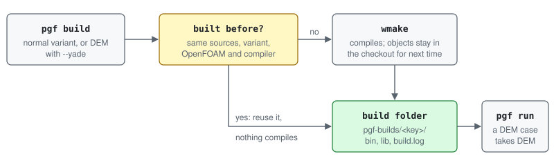

# The build system

For changing PGF's code. There is one way to build: `pgf build` (or `./Allwmake`, which runs it) compiles PGF into a prefix of its own. Installing PGF and YADE on a machine: [Installing](install.md); the tool around the build (settings, choosing a build, running cases): [the pgf tool](pgf.md). This page covers what a build is, editing and rebuilding, the DEM variant, and cleaning.

## How a build works

pgf decides *what* to build and *where* it goes; OpenFOAM's own `wmake` does the compiling:



1. **pgf build** names the build from your sources, the variant (normal or DEM), the OpenFOAM version and the compiler, in a clean shell that loads OpenFOAM.
2. **Built before?** Then it is reused at once: nothing compiles, the checkout is not touched.
3. **Variant switched** between normal and DEM since the last build? pgf cleans the 2 parts that differ (pyrolysis library, solver) so they recompile; you never clean by hand.
4. **wmake** (OpenFOAM's own tool) compiles each part. It keeps compiled pieces next to the source (the **worktree cache**, which makes the next build quick) and puts the solver and libraries in the **build folder**, `pgf-builds/<key>/`.
5. **pgf run** (and `pgf shell`) run cases with that build folder.

`./Allwclean` empties the worktree cache; `pgf gc` removes old build folders.

`utilities/pgf/build.sh` is the engine behind step 4, not a second way in: called directly, it exits with `needs --isolated or --prefix DIR` and names the `pgf build` command to run instead.

## Where things land

| What | Where |
|---|---|
| Source | your checkout |
| `lnInclude/`, `Make/<WM_OPTIONS>/` | beside the source, in the checkout: wmake's object cache (git-ignored, never commit) |
| Libraries, executables | `$PGF_BUILD_ROOT/<build key>/lib`, `…/bin` (the prefix; `pgf build --print-prefix` names it) |
| wmake's output | `<prefix>/build.log`; `pgf build -v` streams it instead |

The build key, the build store `PGF_BUILD_ROOT` and how a command picks its build: [`pgf help build-selection`](pgf-reference.md#pgf-help-build-selection) and [`pgf help config`](pgf-reference.md#pgf-help-config). A prefix is complete once its `.pgf-build.json`, written last, exists; that record's fields, the per-key lock and the registry of checkouts are in `utilities/pgf/build.sh` and `utilities/pgf/registry.py`. OpenFOAM v2606 embeds no RPATH, so a prefix works anywhere as long as its `lib/` is on `LD_LIBRARY_PATH`; nothing is written to OpenFOAM's shared user directories.

## Editing and rebuilding

After editing the sources, run `pgf build` again. The new sources have a new key, so the build goes into a new prefix and recompiles only what wmake finds changed; an unchanged tree is a cache hit and returns at once. The previous prefix stays as it was for whatever still uses it; `pgf gc` removes old ones.

Do not run `wmake` yourself inside `pgf shell`: there the user output directories point at the active build's prefix, so a `wmake` would overwrite a build that its key says came from other sources. `pgf shell` refuses it with `pgf: refusing wmake: it would install into the cached build <key>.` and a pointer to `pgf build`. (OpenFOAM's own `wmake` for coded functions, under a case's `dynamicCode/`, is not affected.)

## Switching variants

`wmake` recompiles by source timestamp and does not notice that `WITH_YADE` changed, so the in-tree objects of the targets whose code differs between the variants (the pyrolysis library and the solver) belong to one variant at a time. `pgf build` records which variant built them; when you build the other one, it drops those targets' `Make/<WM_OPTIONS>/` first and says so:

```
INFO switching to the DEM variant: cleaned the normal objects of pyrolysisModels porousGasificationFoam; they recompile now
```

So `pgf build`, `pgf build --yade`, `pgf build` works with no clean in between. When the wanted prefix already exists, `pgf build` reuses it and leaves the objects alone.

## YADE DEM coupling

`--yade` enables the `DEM` library target and compiles the solver with `WITH_YADE=1`, which switches on the `#ifdef WITH_YADE` coupling code. Without it the solver has no DEM support and Yade hangs waiting for MPI communication.

Building needs no YADE: `pgf build --yade` compiles nothing from it. The OpenFOAM half of the coupling, `pgfDemCoupler`, is PGF code that needs only OpenFOAM, MPI and the `PgfDemBridge` submodule. Running a DEM case needs a YADE built with MPI from yade-pgf at the pin; [install.md](install.md#3-dem-coupling-optional) builds it and checks the coupling.

### The protocol

PGF links nothing from YADE and includes none of its headers. `pgfDemCoupler` and YADE's `PgfCoupling` engine (`pkg/openfoam/PgfCoupling.cpp` in yade-pgf, built into `libpkg_openfoam.so`) both build the same `PgfDemBridge` (protocol v2, [#328](https://github.com/trymarz/porousGasificationFoam/issues/328)). A startup handshake checks that both sides agree, the buffer layout included, and stops both by name on a mismatch; what it compares: [DEM exchange → start and stop](dem-exchange.md#start-and-stop). This run-time check replaces any build-time check of the buffer layout.

### The submodule and its pin

yade-pgf is the submodule `submodules/yade-pgf` (`.gitmodules`). The pinned commit is the gitlink in this repository's tree:

```bash
git submodule update --init submodules/yade-pgf
git -C submodules/yade-pgf submodule update --init extra/PgfDemBridge
git ls-tree HEAD submodules/yade-pgf     # the pinned commit
git submodule status submodules/yade-pgf # a leading '+' means the checkout differs from the pin
```

When the pin moves, rebuild YADE. PGF's `--yade` build does not depend on the pin, so its key ignores it.

`submodules/PgfDemBridge` holds the core of coupling v2 ([#328](https://github.com/trymarz/porousGasificationFoam/issues/328), [PgfDemBridge](https://github.com/trymarz/PgfDemBridge), GPL-3.0-or-later). `pgf build --yade` compiles it into `liblambdaDotModel` (`porousGasificationMedia/DEM/pgfDemCoupler/PgfDemBridge.C`), so the submodule must be checked out (`git submodule update --init submodules/PgfDemBridge`). yade-pgf carries the same repository as `extra/PgfDemBridge`, and both pins must match.

### The pin checks

`pgf shell --yade` (and `run`, `status`, `doctor`, `test dem`) checks the yade binary (`YADE_BIN`, or `yade` on `PATH`) against the pin. The pin is OK; another commit with the same coupling API warns, since it can still give other results; another coupling API fails. `pgf test dem` refuses any yade that is not OK, because its baselines were made with the pin ([`pgf help test`](pgf-reference.md#pgf-help-test) names the override). `pgf doctor --yade` shows the verdict with the command that fixes it ([`pgf help doctor`](pgf-reference.md#pgf-help-doctor)); the rules are in `utilities/pgf/coupling.sh`.

### `YADE_TRUNK`

`YADE_TRUNK` is the yade-pgf source checkout. The build does not read it; `pgf` uses it for the pin checks above (its `PgfCoupling` sources and `py/mpy.py`).

With `--yade`, `pgf` defaults `YADE_TRUNK` to `submodules/yade-pgf`; set it (or `pgf setup --yade-trunk DIR`) to use another checkout.

## Cleaning

`./Allwclean` cleans this checkout's in-tree cache: `lnInclude/` and `Make/<WM_OPTIONS>/` of every target, through `wclean`. Built prefixes are not touched; `pgf gc` removes those. Switching variants does not need it.

`wmake` does not prune a symlink in `lnInclude/` whose source you deleted or renamed. It dangles, so an include of it fails loudly instead of picking up stale content. Run `./Allwclean` after renaming or deleting headers.

## Choosing targets

`pgf build [clean]` acts on all active targets, which you switch on or off with flags; later flags override earlier ones. Every option: [`pgf help build`](pgf-reference.md#pgf-help-build) and `utilities/pgf/build.sh --help`.

```bash
pgf build --apps-only                          # apps on, libs off
pgf build clean --reset-all --radiationModels  # all off, then radiationModels on: clean only that
pgf build --all --no-DEM                       # everything except DEM
```

`./Allwmake` is `pgf build --all --no-DEM` and `./Allwclean` is `pgf build clean --all` (which cleans DEM too); both forward extra arguments.

| Target | Type | Depends on |
|---|---|---|
| DEM (`--yade` only) | library | — |
| fieldPorosityModel | library | — |
| radiationModels | library | solid thermo |
| thermophysicalModels | library suite | — |
| pyrolysisModels | library | all above |
| porousGasificationFoam | executable | all libraries |

## Related pages

- [The pgf tool](pgf.md): settings, builds and runs.
- [Installing](install.md): OpenFOAM, PGF and YADE on a clean machine.
- [Developer tools](dev-tools.md): clangd, Serena, Doxygen.
- [Apptainer images](containers.md): `pgf pack`, an image of one commit for a server.
- [All documentation](README.md)
