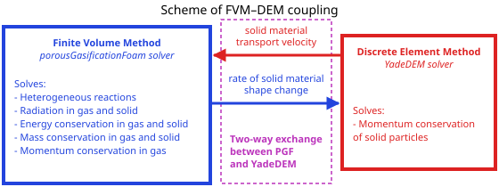

# DEM coupling

PGF can run coupled to YADE, a discrete-element (DEM) code that moves individual bodies. The DEM bodies tell PGF how the solid moves; PGF tells the bodies how their solid changes. The two sides take turns, exchanging data once per PGF time step.

## The idea

Mass, porosity and chemistry stay on the mesh. This is not the usual CFD–DEM picture, where particles set the porosity and the gas drags them.

### What the DEM bodies are

The DEM bodies (YADE `Body` objects) are an analog, chosen by the user to move the solid in a physically plausible way. They are not the solid that PGF models: that solid lives on the mesh as the mass per cell `Ym`, and porosity follows from it (`1 − ε = Σ Ym/ρ`). The bodies carry no mass, and none of their shape or size reaches PGF. The closer they mimic the real material, the more physical the solid velocity is likely to be, but nothing enforces this. Examples:

- a single pellet spanning several cells: bead-spring chains;
- a gasifier bed: loosely packed spheres, because spheres flow smoothly under compaction, not because the real bed is made of spheres;
- bridging in a bed: rougher grains that clog more easily.

### DEM → PGF: the solid velocity

The body velocities, averaged per cell and smoothed over solid cells without bodies, give `U_s`, which moves the solid mass `Ym` and through it the porosity the gas sees. Body positions only decide which cells anchor `U_s`; they enter no PGF equation.

### PGF → DEM: the body length scale λ

The solid changes as it reacts: it shrinks as it burns out, or swells as it heats. That chemistry lives on the mesh, so only PGF knows it. The bodies learn it through one number each, a length scale λ (`State::lambda_` in YADE, starting at 1).

PGF tells each body how its λ changes, in one of two ways. In the rate modes (`constant`, `exactDifferential`) it sends a rate λ̇, which YADE integrates every DEM step. Under `apparentVolume` it sends a factor `r`, which YADE applies to λ once per exchange. The DEM side uses λ to evolve the shape of its bodies. That shape change drives their motion, which comes back to PGF as `UsDEM` for the advection step of the solid transport equation.

What a body does with λ is up to the DEM script. YADE only stores and updates it; in the tutorial fixtures the spring model stretches its rest length by it ([DEM exchange](dem-exchange.md#the-fixtures-spring-model)).

### Consistency

**One-way, in cycles.** Each side takes the other's latest data as it is, updates its own state and sends its new fields back. PGF does not correct the body velocities, and YADE does not correct λ̇ or `r`. The two descriptions are not tied together beyond this exchange, so their coherence is hoped for, not enforced.

**Left out on purpose:** drag and torque on the bodies; what λ does not change in YADE: [Limitations](#limitations).

## Body size models

`lambdaMode` in `constant/lambdaDict` chooses what a body's λ follows:

| `lambdaMode` | λ follows | Use |
|---|---|---|
| `constant` (default) | a fixed rate `λ̇ = lambdaValue` | testing, or a prescribed swelling or shrinking |
| `exactDifferential` | `T_s` and the solid composition, through `λ̇ = (∂λ/∂Tₛ) dTₛ/dt + Σᵢ (∂λ/∂Ymᵢ) Rᵢ` | a closed-form law for how size depends on thermal expansion and mass change |
| `apparentVolume` | the apparent volume of the solid in the body's cell | bodies that shrink or swell with what the chemistry leaves |

### Body size under `lambdaMode apparentVolume`

A body is meant to grow or shrink with the solid it stands for. As the chemistry converts one solid specie into another, or into gas, the envelope volume of the solid in a cell changes, and so does each body in it. One kilogram of solid specie `k` fills `1/ρ_app,k` of envelope volume, pores included (`rhoApparent` in `solidThermophysicalProperties`). Before this step's reactions the solid in a cell takes up `V_old`; the reactions change it by `ΔV_chem`:

$$
V_{\mathrm{old}} = \sum_k \frac{\mathrm{Ym}_k}{\rho_{\mathrm{app},k}}, \qquad \Delta V_{\mathrm{chem}} = \Delta t \sum_k \frac{R_k}{\rho_{\mathrm{app},k}}
$$

A body's volume scales with `λ³`, so λ scales with the cube root of the volume ratio:

$$
r = \sqrt[3]{1 + \Delta V_{\mathrm{chem}}/V_{\mathrm{old}}}, \qquad \lambda \leftarrow r\,\lambda
$$

Only chemistry changes the size: solid transport moves bodies without resizing them. Every body in a cell gets the same `r`.

## Limitations

- **The YADE radius, mass and inertia do not follow λ** (#206), and λ enters no PGF equation. Nothing in YADE reads `lambda_` except the fixtures' springs.
- **One value per cell.** Every body in a cell gets the cell's `λ̇` or `r`, whatever its own composition.
- **Units of λ.** `lambda`, `lambdaDEM` and `lambdaBackgroundValue` are declared in m, and `λ̇` in m/s. In the fixtures' spring model λ starts at 1 and multiplies a rest length, so it acts as a stretch ratio.

## Related pages

- [DEM exchange](dem-exchange.md): the exchange step, fields, time step and the fixtures' spring model.
- [Theory](theory.md): the gas–solid model.
- [All documentation](README.md)
