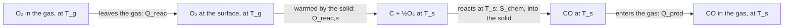

# Theory

What the solver models: the physics, its assumptions and the equations. Where each piece lives in the source, and the order the solver runs them: [code map](code-map.md). The equations are short-form summaries checked against the code, with the model first described in [Żuk et al. 2022](https://doi.org/10.1016/j.cpc.2022.108407) (CPC 278, 108407); reaction kinetics, diffusive resistance, reaction enthalpies, heat-transfer correlations and the radiation models are described there (§2.2–2.4) and in the source. **If this page and the code differ, the code wins** — please open an issue or PR.

In the paper the solid stays in place, and its porosity changes through a chemistry source term. Here the solid can move with the velocity `Us`, and porosity is recomputed each step from the solid mass in the cell. The solid equations below therefore differ from the paper's (3a–3c).

## Model overview

Each cell holds gas and solid in proportions set by the porosity `ε` (`porosityF`): `ε = 1` is pure gas, `ε = 0` pure solid, and anything in between is a porous medium.

Gas and solid exchange mass and energy. The solid reactions can consume and produce both solid and gas species, and release or absorb heat; the two phases also exchange heat by convection, and radiation reaches both.

Momentum goes one way only. The solid slows the gas through the Darcy–Forchheimer resistance, but the gas does not push the solid, and gas released by the solid brings no momentum with it. The solid's velocity `U_s` is given in `0/Us` or comes from DEM. DEM coupling needs a `WITH_YADE` build with `constant/yadeProperties` `active true`; it replaces the prescribed `U_s` and nothing else in the equations below. In return PGF sends each DEM body how its length scale λ changes, from the solid chemistry. The idea and the body size models: [DEM coupling](theory-DEM.md); the exchange step: [DEM exchange](dem-exchange.md).

## Notation

| Symbol | Field | Meaning |
|---|---|---|
| `ε` | `porosityF` | gas volume fraction |
| `ρ_g` | `rho` | gas density |
| `φ_g` | `phi` | gas mass flux |
| `Y_g,i` | `<gasName>` | gas species mass fractions |
| `T_g`, `T_s` | `T`, `Ts` | gas, solid temperature |
| `Ymₖ` | `Ym` | solid mass per **cell** volume [kg/m³], one per solid specie |
| `Ysₖ` | `Y<solidName>` | solid mass fractions |
| `ρ_s,k` | `rho` | skeletal density of solid specie `k` |
| `ρ_s` | `rhos` | skeletal density of the solid mixture |
| `ρ_app,k` | `rhoApparent` | apparent density of solid specie `k` |
| `U_s` | `Us` | solid velocity |
| `φ_s` | `phiSolid` | limited solid volume flux |

- **Densities.** Skeletal is the material without its pores; apparent is a particle's mass over its envelope volume, pores included. Both are per-specie entries in `solidThermophysicalProperties`; `rhoApparent` is optional and only `lambdaMode apparentVolume` reads it. The mixture's skeletal density is `1/ρ_s = Σₖ Ysₖ/ρ_s,k`, and its bulk density `ρ_s (1 − ε)`.

## Equations

Colours mark the kind of term: ${\color{blue}\text{storage}}$, ${\color{orange}\text{advection}}$, ${\color{green}\text{diffusion}}$, ${\color{red}\text{gas–solid exchange}}$, ${\color{purple}\text{other sources}}$.

### Gas

**Continuity** (`rhoEqn.H`; paper 2b)

$$
{\color{blue}\frac{\partial(\varepsilon\rho_g)}{\partial t}} + {\color{orange}\nabla\cdot\varphi_g} = {\color{red}S_\rho}
$$

**Species** (`YEqn.H`; paper 2a). Fractions are clipped at 0 and renormalised to sum to 1 after each solve.

$$
{\color{blue}\frac{\partial(\varepsilon\rho_g Y_{g,i})}{\partial t}} + {\color{orange}\nabla\cdot(\varphi_g Y_{g,i})} - {\color{green}\nabla\cdot(\mu_{\mathrm{eff}}\nabla Y_{g,i})} = {\color{purple}\varepsilon R_{\mathrm{hom},i}} + {\color{red}S_{\rho,i}}
$$

`R_hom,i` is the gas-phase reaction rate per unit gas volume, hence the `ε` (#226). The interface sources `S_ρ` and `S_ρ,i` are per unit total volume and carry none (#125).

**Momentum** (`UEqn.H` with `fieldPorosityModel`; paper 2d)

$$
{\color{blue}\frac{\partial(\rho_g U_g)}{\partial t}} + {\color{orange}\nabla\cdot(\varphi_g U_g)} + {\color{green}\nabla\cdot R_{\mathrm{eff}}} = {\color{purple}\rho_g g - \nabla p} - {\color{red}C\cdot U_g}
$$

$$
C = \left(\mu + \frac{f\rho_g|U_g|\sqrt{3}}{|D_f|}\right) D_f
$$

`U_g` is the superficial velocity: `φ_g` is the face flux of `ρ_g U_g` (`compressibleCreatePhi.H`), and `rhoEqn.H` pairs it with `∂(ερ_g)/∂t`. `D_f` is the Darcy resistance tensor (`0/Df`) and `f` the Forchheimer coefficient (`forchheimerCoeff` in `constant/porosityProperties`, default 0, so Darcy only). The paper writes the non-Darcy term in a different form; the code is as above.

**Energy** (`EEqn.H`; paper 2c). Solved for sensible enthalpy `h_g` (or internal energy, depending on the thermo type); `K` is kinetic energy.

$$
\begin{aligned}
&{\color{blue}\frac{\partial(\varepsilon\rho_g h_g)}{\partial t} + \frac{\partial(\varepsilon\rho_g K)}{\partial t}} + {\color{orange}\nabla\cdot(\varphi_g h_g) + \nabla\cdot(\varphi_g K)} - {\color{purple}\varepsilon\frac{\partial p}{\partial t}} - {\color{green}\nabla\cdot(\alpha_{\mathrm{eff}}\nabla h_g)} \\
&\quad = {\color{purple}\varepsilon\dot Q_{\mathrm{chem}}} + {\color{red}Q_{\mathrm{conv}} + Q_{\mathrm{prod}} + Q_{\mathrm{reac}} + S_{\mathrm{rad}}}
\end{aligned}
$$

Solved for internal energy `e`, the pressure work `− ε ∂p/∂t` becomes `∇·(φ_g/ρ_g p) + p ∂ε/∂t` (from `h = e + p/ρ`; see the `EEqn.H` Description).

### Gas–solid exchange

#### Mass

Gas and solid exchange mass only through the solid reactions. A solid reaction may have solid and gas species on both sides: solid and gas reactants turn into solid and gas products. For example, in gasification, char reacts with a gasifying agent such as O₂ or CO₂ to give gases; in pyrolysis, wood gives char and volatiles. Each reaction must conserve mass; this is checked when it is read.

The solid chemistry reports this per cell as three rates, each in kg per m³ of cell per second:

- `R_k` (code: `RRs(k)`): how fast solid species `k` is made (> 0) or consumed (< 0). It drives the solid species equation.
- `S_ρ,i` (code: `RRg(i)`): how fast gas species `i` enters the gas as a product (> 0) or leaves the gas as a reactant (< 0). It is 0 for gas species that take part in no solid reaction. It drives the gas species equation.
- `S_ρ = Σᵢ S_ρ,i` (code: `Srho`): the net gas mass gained. It drives the gas continuity equation.

All three come from one chemistry ODE per cell, integrated over the time step at the start of the solid step; they are the mean rates over that step. The gas and solid equations then use the same values, so both sides see one consistent exchange. For more detail, such as what each rate is normalised by, how it is split among species and which quantities stay fixed while the ODE is integrated, see the `Description` at the top of `ODESolidHeterogeneousChemistryModel.H` (#209; paper Eq. 4–6, 10, 12).

#### Solid reaction rates

Each solid reaction's rate is defined per kg of its solid substrate (Żuk et al. 2022, Eq. 4–5), and every coefficient is a mass per kg of that substrate. In `hem = 0.6 CH4 + 0.4 char`, 1 kg of hem gives 0.4 kg of char. So:

- **A lone solid substrate's coefficient has no effect.** `2 wood = 2 tar` behaves like `wood = tar`, and the solver warns about it at start-up. To split one solid among competing branches, give each branch its own reaction and put the branch fraction into its `A`.
- **Gas substrates count per kg of solid too** (Eq. 6; #201). In `char + 1.33 O2 = 2.33 CO`, each kg of char consumed takes 1.33 kg of O₂ and gives 2.33 kg of CO, and `heatOfReaction` is per kg of char. Inputs written for the rule before #201: [case guide → reaction inputs from before #201](case-guide.md#reaction-inputs-from-before-201).
- **Diffusion limit.** With `diffusionLimitedReactions`, each gas reactant's resistance in Eq. 10, 1/Ω_diff, is multiplied by its mass coefficient (ξ_a/Σ, e.g. 1.33 for O₂ above). At the diffusion limit the reactant consumed then equals what Eq. 9 delivers. This departs from the literal Eq. 10, under which the consumption would be ξ_a/Σ times the delivery. Stoichiometric mode does the same with the gas reactant's mass coefficient in that mode, e.g. 16/12 = 1.33 kg of O₂ per kg of char in `char + 0.5 O2 = CO` (#209).

#### Energy

Gas and solid each have their own temperature, `T_g` and `T_s`. Energy passes between them by convection, with the mass that crosses the interface, and as radiation. The convection and interface terms are computed once per step, from the step-start temperatures, in cells whose solid is connected at the start of the step. Gas and solid read the same stored values, so what one phase loses the other gains in the same step. Which code computes each term: [code map](code-map.md#gassolid-energy-terms).

| Route | Gas | Solid |
|---|---|---|
| Convection | $+Q_{\mathrm{conv}}$ | $-Q_{\mathrm{conv}}$ |
| Gas products | $+Q_{\mathrm{prod}}$ | leaves with the converted mass |
| Gas reactants | $+Q_{\mathrm{reac}}$ (< 0) | $-Q_{\mathrm{reac},s}$ |

With `frozenTemperature` (formerly `equilibrium`, in `pyrolysisCoeffs`) no energy equation is solved at all: both temperatures stay at their initial values, each phase its own, and all exchange terms are zero.

*Convection.* $Q_{\mathrm{conv}} = h_v\,(T_s - T_g)$, where `h_v` [W/m³/K] is the volumetric heat transfer coefficient from the model chosen in `heatTransferProperties`; it is zero where there is no solid. With `subintegrateHeatTransfer` the code uses the exact two-temperature relaxation over the step instead, which stays stable for large `h_v`.

*Mass crossing the interface.* Gas that crosses carries its sensible enthalpy `h_i` at the temperature of the phase it leaves, the donor. The sign of `S_ρ,i` picks the donor:

- A gas product (`S_ρ,i > 0`) is born in the solid and enters the gas at `T_s`.
- A gas reactant (`S_ρ,i < 0`) leaves the gas at `T_g`. The solid then warms it to `T_s`, where it reacts.

$$
Q_{\mathrm{prod}} = \sum_{S_{\rho,i}>0} S_{\rho,i}\,h_i(T_s), \qquad
Q_{\mathrm{reac}} = \sum_{S_{\rho,i}<0} S_{\rho,i}\,h_i(T_g)
$$

$$
Q_{\mathrm{reac},s} = \sum_{S_{\rho,i}<0} |S_{\rho,i}|\,\bigl(h_i(T_s) - h_i(T_g)\bigr)
$$

- `Q_prod` and `Q_reac` go into the gas energy equation. Both are `h` even when the gas solves for `e`: entering mass brings its flow work.
- `Q_reac,s` is taken from the solid energy equation.

*The solid's half of a gas product.* The solid has no explicit product term. Its storage terms use the pre-reaction mass, and `H` is then stored on the mass that remains. Together they equal $\frac{dH}{dt} - \sum_k R_k c_{p,k} T_s$, so the converted solid leaves with its sensible heat at `T_s`. An explicit term would count it twice.

*Reaction heat.* It is booked once, in the solid, as `S_chem`, with every participant at `T_s`. `solidReactionEnergyFromEnthalpy` in `chemistryProperties` (default `true`) picks how it is computed:

- `false`: `S_chem` is each reaction's `heatReact` times its rate. `heatReact` must then be the heat of reaction with all participants at `T_s`; `Q_reac,s` is what brings the gas reactants there. It is a constant, not corrected with temperature, so give the value at reaction temperature (e.g. from a TGA/DSC fit), not a 298 K standard value (#212).
- `true`: $S_{\mathrm{chem}} = -\sum_k R_k\,h_k(T_s) - \sum_i S_{\rho,i}\,h_{a,i}(T_s)$, with `h_a,i` the gas absolute enthalpy (formation plus sensible). Then $S_{\mathrm{chem}} - Q_{\mathrm{reac},s}$ is the solid's open-system balance, with gas reactants in at `T_g` and products out at `T_s`; `Q_reac,s` only splits it into two terms.

For char oxidation, C + ½O₂ → CO, the steps are:

By Hess's law the direct route from O₂ at `T_g` to CO at `T_s` gives the same total. The code books it in steps so that each has one sender and one receiver.

*Why the source is at the donor's temperature.* The gas energy equation is conservative: it solves for the energy in the cell, `ερ_g h_g` (`fvm::ddt(porosityRho, he) + fvm::div(phi, he)`, `EEqn.H`). Mass added by `S_ρ` without a matching energy source would arrive with `h = 0`, which for sensible enthalpy is 298.15 K. That was the case before #213; the old `heatUpGas` term only partly corrected it. In the non-conservative form, `ρ_g Dh_g/Dt`, the same omission is silent: new mass takes the cell's `h`, as if born at `T_g`. OpenFOAM's compressible solvers (`rhoPimpleFoam`, `reactingFoam`) use the conservative form too.

*Reference temperatures.* The gas `h_i` counts from 298.15 K, the solid `H` from 0 K. The offset is absorbed in `heatReact` (it is defined at `T_s`) or, in enthalpy mode, in the `−c_p,k T_std` term of the solid `h_k(T)`; no temperature depends on it. It cancels exactly only for constant `c_p` (#173).

*Radiation.* `S_rad` and `S_rad,s` are the gas and solid radiation sources (`radiation.H`). With `heterogeneousP1` the gas receives `a·G − 4·a·σ·T⁴ − E`: it absorbs `a·G` and loses its own emission `4·a·σ·T⁴`, the same term that feeds the `G` equation, so a gas at `G = 4σT⁴` has no net source. `E` is an extra constant sink, not needed for that balance.

### Solid

**Motion.** No equation solves for `U_s`. It is prescribed in `0/Us` (fixed in time) or, with DEM, interpolated from `UsDEM`, the raw cell mean of the DEM body velocities (`interpolationMode` in `constant/lambdaDict`; [DEM coupling](theory-DEM.md#the-idea)). The solid actually moves with the limited volume flux

$$
\varphi_s = L_f\,(\mathbf{U}_s\cdot\mathbf{S}_f), \qquad 0 \le L_f \le 1
$$

where `S_f` is the face area vector and `L_f` the factor from `solidFluxLimiter`, chosen so no cell gives more solid than it holds or takes more than it has room for. This keeps `Ym` non-negative.

**Species** (`SolidSpeciesTransport::solve`; paper Eq. 3a plus solid advection, which the paper does not have). `Ym_k` is the mass of solid species `k` per m³ of cell. It changes through the solid reactions (`R_k`) and, when the solid moves, through the solid flux `φ_s`:

$$
{\color{blue}\frac{\partial\,\mathrm{Ym}_k}{\partial t}} + {\color{orange}\nabla\cdot(\varphi_s\,\mathrm{Ym}_k)} = {\color{red}R_k}
$$

**Porosity** (`PorosityRecovery::updatePorosity`). Not transported; derived from the solid mass each step, so both chemistry and solid motion change it. Handling of nearly empty cells: [solid-step.md](solid-step.md), stages 9–10.

$$
1-\varepsilon = \sum_k \frac{\mathrm{Ym}_k}{\rho_{s,k}}
$$

**Energy** (`SolidEnergy::solve`, after the species step; paper 3c). The solid enthalpy `H = Σₖ Ym_k c_p,k T_s` (`solidH`) is stored, advected with the solid and conducted through it:

$$
{\color{blue}\frac{\partial H}{\partial t}} + {\color{orange}\nabla\cdot\Bigl(\sum_k \varphi_{\mathrm{Ym},k}\,c_{p,k}T_s\Bigr)} - {\color{green}\nabla\cdot\bigl((1-\varepsilon)K_s A\,\nabla T_s\bigr)} = {\color{purple}S_{\mathrm{chem}}} {\color{red}\;-\;Q_{\mathrm{conv}} - Q_{\mathrm{reac},s} + S_{\mathrm{rad},s}}
$$

`A` is the optional `anisotropyK` tensor; `S_chem` is the solid reaction heat (`chemistrySh`), with all participants at `T_s`. The equation is solved for `T_s`; how the storage term handles this step's composition change: [solid-step.md](solid-step.md), stage 7. Exchange terms and reference temperatures: [Gas–solid exchange](#gassolid-exchange).

#### Solid regimes

Every cell is in one of four solid regimes, ordered by its solid volume fraction α = 1 − ε. The thresholds (`solidRegimes` in `pyrolysisProperties`, [keys](case-reference.md#constantpyrolysisproperties)) are solid fractions, and each one ends the regime below it:

| Regime | Solid fraction | What the solver does |
|---|---|---|
| empty | α = 0 | gas only |
| trace | α ≤ `dispersedAboveSolidFraction` | too little solid to trust its own temperature: `T_s` is the gas temperature |
| dispersed | α ≤ `connectedAboveSolidFraction` | the solid no longer forms a connected matrix: no solid source terms, and the cell may be emptied (`bedCollapse`, `emptyFlippedCells`) |
| connected | α ≤ `maxSolidFraction` | the full model |

The regimes hold at any scale: a cell may be a piece of one pellet, where α counts the pores inside it, or hold many pellets, where α counts the gaps between them too. Only the values are case-specific.

- `dispersedAboveSolidFraction` changes results. Below it, `T_s = H/(ρ c_p)` is a ratio of two vanishing numbers whose errors do not shrink with them. `heterogeneousP1` uses the same threshold: only cells above it attenuate radiation as solid.
- `connectedAboveSolidFraction` is also the threshold of the DEM coupling: where the solid is not connected, `lambdaDot` is off and the interpolation models treat the cell as outside the solid.
- `maxSolidFraction` is the packing cap: the solid flux limiter refuses any flux that would carry a cell past it. It must stay below 1, since the gas equations divide by the gas volume.
- `dispersedSolidTemperature gas` takes the gas temperature in dispersed cells too. The energy the solid loses that way is not charged anywhere.

## Related pages

- [Code map](code-map.md): where each model lives, and the per-time-step flow.
- [Solid step](solid-step.md): the solid step, stage by stage.
- [DEM coupling](theory-DEM.md): the YADE coupling.
- [DEM exchange](dem-exchange.md): the exchange with YADE.
- [Case guide](case-guide.md) and [case reference](case-reference.md): setting up a case, and its keys.
- [All documentation](README.md)
